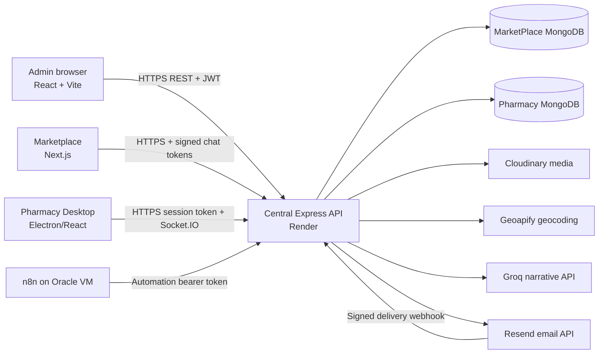
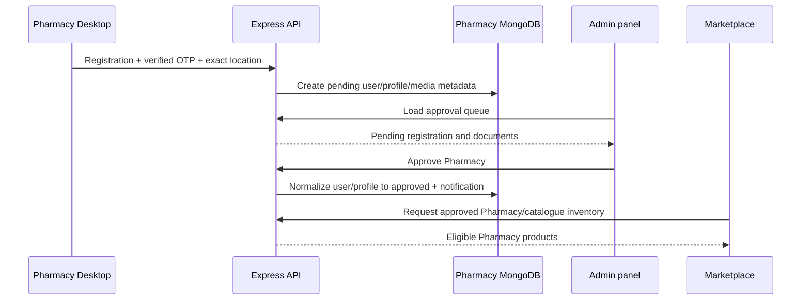
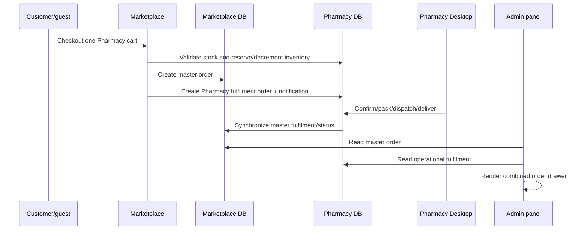
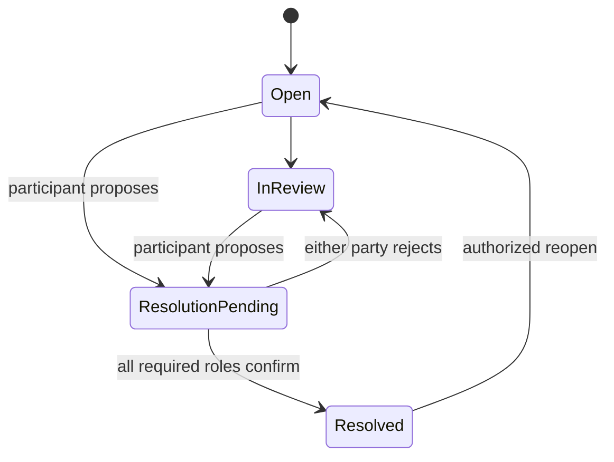

# Ahtisham's Admin panel and it's features

## 1. Purpose of this document

This document explains the DawaConnect Admin panel as it is actually implemented in the source code. It covers:

- the overall architecture and why it was selected;
- the Admin web application's pages and user flows;
- the REST API and service-layer logic behind every Admin feature;
- the shared backend capabilities that also serve the Marketplace and Pharmacy Desktop application;
- the two MongoDB databases, their collections, important fields and ownership rules;
- the external services, libraries and security controls used by the system;
- the end-to-end data flow between the three DawaConnect modules.

This is an **as-built technical explanation**, not merely a list of planned requirements. Paths such as `Admin module/src/pages/DashboardPage.jsx` are included so a developer can find the implementation quickly.

---

## 2. Executive overview

DawaConnect's Admin module is a split full-stack system:

1. A **React single-page application (SPA)** provides the browser-based Admin console.
2. A central **Node.js and Express API** performs authentication, validation, business logic and database access.
3. **MongoDB Atlas** stores operational data in two logical databases: `MarketPlace` and `Pharmacy`.
4. The same Express server also hosts shared services used outside the visible Admin console, including Pharmacy Desktop APIs, live order chat, medicine catalogue APIs, pharmacy analytics, AI narrative reports, PDF/Excel exports and the n8n monthly-report automation endpoints.
5. **Socket.IO** supplies real-time chat and Pharmacy Desktop notification events.

The visible Admin frontend and the backend are deployed separately:

- the Admin SPA is suitable for deployment on **Vercel**;
- the persistent Express/Socket.IO API is suitable for deployment on **Render**, exposed through the configured API domain;
- MongoDB Atlas, Cloudinary, Geoapify, Resend, Groq and the self-hosted n8n instance are external managed or self-hosted dependencies.

### High-level topology



---

## 3. Architectural style and why it was used

### 3.1 Client-server architecture

The Admin interface is a client-server application. The browser never connects directly to MongoDB, Cloudinary, Resend or any other secret-bearing service. It calls the Express API through `VITE_API_BASE_URL`.

This design was chosen because it:

- keeps database credentials, JWT secrets and third-party API secrets off the browser;
- allows the server to enforce authorization on every operation;
- creates one trusted location for validation, audit logging and cross-database coordination;
- lets the frontend be deployed as fast static assets while the backend remains independently deployable;
- permits the Marketplace, Pharmacy Desktop app and n8n to reuse controlled backend functionality.

### 3.2 React single-page application

The Admin frontend is a React SPA built by Vite. React Router changes screens without a full browser reload. A single application shell owns the responsive sidebar, top bar, theme, health indicator and account menu, while the active page is rendered inside it.

Why this fits the Admin panel:

- administrators repeatedly move between orders, pharmacies, complaints and detail drawers;
- shared state such as authentication, notification badges, theme and toast messages remains available during navigation;
- client-side filtering, sorting and pagination make operational tables feel immediate;
- one responsive component system can serve desktop, tablet and smaller screens.

### 3.3 Layered modular backend, implemented as a modular monolith

The backend is one deployable Node.js process, but its code is divided into layers:

- **routes** define HTTP endpoints and their middleware;
- **middleware** handles Admin JWTs, Pharmacy sessions, chat JWTs and automation secrets;
- **services** implement workflows such as chat, complaints, catalogue images and analytics;
- **models** define MongoDB document structures;
- **sockets** handle real-time events;
- **database connection modules** own the separate Marketplace and Pharmacy connections.

This is a modular monolith rather than a collection of microservices. That is appropriate for an FYP/startup-stage system because it provides clear code boundaries without the cost of deploying, authenticating and monitoring many small services. It can still be split later if traffic or team size demands it.

### 3.4 Two-database integration architecture

The API opens two Mongoose connections:

- the default Mongoose connection uses `MONGODB_URI` and points to `MarketPlace`;
- `mongoose.createConnection(PHARMACY_MONGODB_URI)` points to `Pharmacy`.

The databases are separated because the modules have different ownership and lifecycles:

- `MarketPlace` owns customers, master checkout orders, complaints, Admin accounts, audit logs and order-chat records;
- `Pharmacy` owns pharmacy registration/authentication, storefront profiles, inventory, per-pharmacy operational orders, reviews, notifications, catalogue data and analytics/report records.

The Admin backend intentionally has read/write access to both because it is the oversight and integration layer. The code comments define ownership rules; for example, Marketplace owns the master order while the Pharmacy database owns its fulfilment copy.

### 3.5 Event-driven real-time additions

REST is used for normal queries and mutations. Socket.IO is added for data that benefits from immediate delivery:

- live human-to-human order chat;
- unread chat state;
- Pharmacy Desktop order/notification events.

MongoDB change streams watch Pharmacy notifications where supported. This prevents the desktop app from relying only on frequent polling.

---

## 4. Source-code structure

```text
Admin module/
├── src/                         React Admin SPA
│   ├── pages/                   Route-level screens
│   ├── features/                Detail drawers and feature-specific UI
│   ├── components/layout/       Responsive application shell
│   ├── components/ui/           Reusable controls, tables and charts
│   ├── context/                 Auth, theme, badges and toast state
│   ├── hooks/                   Query/polling/debounce helpers
│   └── lib/                     API client, navigation and formatting
├── server/                      Express API and Socket.IO server
│   ├── routes/                  REST endpoints
│   ├── middleware/              Authentication/authorization
│   ├── models/                  Mongoose schemas
│   ├── services/                Business and integration logic
│   ├── sockets/                 Live-chat socket protocol
│   └── db/                      Pharmacy database connection
├── scripts/                     Catalogue import utility
├── package.json                 Dependencies and test commands
└── .env.example                 Documented configuration contract
```

---

## 5. Frontend foundation and common data flow

### 5.1 Application startup and routing

`src/App.jsx` creates the providers in this order:

1. `ThemeProvider`
2. `ToastProvider`
3. `AuthProvider`
4. `BrowserRouter`
5. protected `BadgesProvider` and `AppShell`

Public routes are `/login` and `/register`. Protected routes are:

- `/` — Dashboard
- `/orders` — Orders
- `/complaints` — Complaints
- `/pharmacies` — Pharmacies
- `/approvals` — Pharmacy approvals
- `/customers` — Customers
- `/medicine-catalog` — Shared medicine catalogue
- `/audit` — Audit log
- `/admins` — Admin management, visible only to a super admin

`RequireAuth` restores and validates the saved session before rendering protected pages. If authentication is missing, it preserves the requested URL and redirects to login. A successful login returns the administrator to that URL.

### 5.2 API client

`src/lib/api.js` creates one Axios client with:

- a base URL from `VITE_API_BASE_URL`;
- a 30-second timeout;
- an interceptor that attaches `Authorization: Bearer <admin-token>`;
- a response interceptor that clears the local session on a `401` and notifies the Auth context.

The module exposes named functions such as `AdminAPI.dashboard()`, `AdminAPI.pharmacy360(id)` and `AdminAPI.importMedicineCatalogCsv(csvText)`. Keeping URLs in one client prevents each page from inventing its own request format.

### 5.3 Query, polling and stale-response protection

The custom `useQuery` hook is the Admin panel's small data-fetching layer. It provides:

- `data`, `loading`, `error` and `updatedAt` state;
- manual and silent refetching;
- optional polling;
- an `enabled` flag for conditional queries;
- protection against a slower obsolete request overwriting a newer result;
- `setData` for optimistic local updates.

`useDebounced` delays text-filter updates so large lists are not re-filtered on every keypress.

### 5.4 Shared responsive interface

`AppShell` provides:

- desktop and mobile navigation;
- a collapsible sidebar whose preference is stored locally;
- route-aware page titles;
- role-aware navigation, hiding super-admin-only items;
- badge counts refreshed every 45 seconds;
- an API/database health check every 60 seconds;
- light, dark and system theme choices;
- an Admin account menu and logout;
- reusable drawers, modals, confirmation dialogs, tables, badges, skeletons and empty/error states.

The DataTable component provides sorting, pagination, responsive column hiding and row actions. Detail records open in drawers so an administrator can inspect an entity without losing the list and filters underneath.

---

## 6. Admin authentication and authorization

### 6.1 Registration

An applicant submits name, email and password to `POST /api/admin/signup`.

The server:

1. normalizes the email;
2. checks that the password is at least eight characters and contains an uppercase letter and special character;
3. hashes the password with `bcryptjs` using cost factor 10;
4. creates the first-ever Admin as an approved `superadmin`;
5. creates later applicants as `admin` with `pending` status.

This bootstrap rule allows a fresh installation to create its initial owner without manually editing MongoDB while ensuring later accounts require approval.

### 6.2 Login and session restoration

`POST /api/admin/login` verifies the account, approval state and bcrypt password. It returns a signed JWT containing the Admin ID and role. The default expiry is controlled by `JWT_EXPIRES_IN` and is documented as eight hours.

The frontend stores the token and a non-secret Admin view in local storage. On every new page load, `/api/admin/me` revalidates the token and current account state. Therefore, deleting an Admin or changing approval state takes effect even if an old browser still contains a token.

### 6.3 Authorization levels

- `requireAuth` verifies the JWT, reloads the Admin and requires approved status.
- `requireSuperadmin` restricts sensitive account and catalogue mutations.
- the UI also hides restricted controls, but server middleware remains the real security boundary.

Super admins can approve/remove Admin users and create/edit/import medicine catalogue entries. A normal Admin can perform the remaining operational oversight tasks. The current account cannot delete itself, and a super-admin account cannot be deleted through the console.

### 6.4 Data involved

Collection: `admins` in `MarketPlace`.

Important fields:

- `name`, `email`, `password` hash;
- `role`: `superadmin` or `admin`;
- `status`: `pending` or `approved`;
- `createdAt`, `updatedAt`.

---

## 7. Dashboard

### Purpose

The Dashboard is a live operational summary rather than a static mock-up. It polls `GET /api/users/dashboard` every 60 seconds.

### Information shown

- total and last-30-day Marketplace orders;
- period-over-period order change;
- last-30-day and previous-period revenue;
- delivered all-time revenue;
- approved pharmacy count and pending count;
- total, new and suspended customers;
- orders/revenue per day for the last 30 days;
- all-time order distribution by status;
- orders grouped by delivery city;
- top pharmacies by non-cancelled fulfilment revenue;
- actionable counts for pending pharmacies, open Admin complaints, pharmacy-handled complaints and pending Admin accounts;
- recent master orders;
- recent audit actions.

### Data flow

1. The React page calls `AdminAPI.dashboard()`.
2. The Express route reads Marketplace users, master orders, complaints and audit logs, plus Pharmacy registrations.
3. Aggregation logic calculates date windows, status counts, city totals and per-pharmacy fulfilment totals.
4. The API returns a purpose-built dashboard view model rather than exposing raw documents.
5. Recharts components render trends and category bars; the rest is displayed through cards, badges and compact tables.

### Why this approach

Calculations are performed on the server so there is one definition of metrics and the browser does not need full database access. The frontend receives only the data required to draw the dashboard.

### Main implementation

- UI: `src/pages/DashboardPage.jsx`
- API: `GET /api/users/dashboard`
- Libraries: React, Recharts, Lucide React and the shared `useQuery` hook
- Collections: `orders`, `users`, `complaints`, `auditlogs` in Marketplace; `users` in Pharmacy

---

## 8. Orders oversight

### Purpose

The Orders page presents Marketplace master orders and the per-pharmacy fulfilment that belongs to each order. The Admin interface is intentionally an oversight interface: Pharmacy Desktop performs normal fulfilment status changes, and Admin displays the synchronized result.

### List features

- polls the newest orders every 30 seconds;
- loads up to the latest 1,000 records;
- searches by order ID, customer, pharmacy, delivery recipient or city;
- filters by order status, pharmacy and date range;
- sorts and paginates responsive columns;
- calculates filtered order, revenue, delivered and cancelled totals;
- exports the filtered view to CSV.

### Order drawer

Opening an order shows:

- master order ID, status and timeline;
- registered customer or guest identity;
- delivery address and phone;
- payment method and payment state;
- item, subtotal, delivery, processing and total amounts;
- estimated delivery and timestamps;
- each pharmacy fulfilment with its Pharmacy order ID, status, items and charges;
- cancellation and partial-delivery explanations;
- links to the relevant customer and pharmacy records.

### Data flow

1. Marketplace checkout writes one master order in `MarketPlace.orders` and one pharmacy-owned order in `Pharmacy.orders`.
2. Each master fulfilment stores the Pharmacy ID and Pharmacy order reference.
3. `GET /api/users/all-orders` joins customer summaries for the list.
4. `GET /api/users/order/:id` retrieves the master order and matching Pharmacy order records.
5. The drawer groups master items by `pharmacyId` and shows the latest Pharmacy fulfilment status.
6. Pharmacy-side cancellation logic restores reserved inventory and synchronizes the Marketplace order status.

### Important ownership rule

`MarketPlace.orders` is the accounting/customer-facing source of truth for the master order. `Pharmacy.orders` is the pharmacy's operational fulfilment view. Admin reads both; it does not casually overwrite order status from the Orders page.

### Main implementation

- UI: `src/pages/OrdersPage.jsx`
- API: `GET /api/users/all-orders`, `GET /api/users/order/:id`
- Models: `Order.js`, `PharmacyOrder.js`
- Libraries: Mongoose, React, shared DataTable and CSV utility

---

## 9. Pharmacy directory and Pharmacy 360

### Pharmacy list

The Pharmacies page reads real Pharmacy registrations and product counts. It provides:

- search by pharmacy, owner, email, phone, city or licence;
- city filter;
- approved, pending, suspended and rejected tabs;
- responsive sorting and pagination;
- CSV export;
- quick lifecycle actions;
- a Pharmacy 360 detail drawer.

### Pharmacy 360 drawer

The drawer combines records from multiple Pharmacy and Marketplace collections.

#### Overview tab

- registration name, owner, email, phone, CNIC and drug sale licence number;
- optional drug sale licence document image;
- registration, approval, suspension and rejection information;
- exact map location and address data;
- Pharmacy-managed storefront name, status, hours and logo;
- delivery charge, delivery radius and delivery type;
- bank information;
- inventory categories;
- key counts: products, low/out-of-stock products, expiring products, fulfilments, revenue and rating.

#### Inventory tab

- product name, category and unit;
- current price and quantity;
- low-stock threshold;
- expiry state;
- missing-price, out-of-stock, low-stock and stock-value summaries;
- inventory CSV export.

#### Orders tab

- recent Pharmacy operational orders and Marketplace fulfilments;
- order source, date, status and total;
- most recent 60 fulfilment records.

#### Complaints tab

- complaints filed by the Pharmacy to DawaConnect;
- complaints filed by customers about that Pharmacy;
- open/total counts and direct links to the correct complaint scope.

#### Reviews and returns tab

- verified customer reviews, rating and comment;
- rating summary;
- existing return-request records where present.

Returns are retained as a compatible operational collection, but DawaConnect's current order-cancellation workflow is handled through checkout/chat rather than a separate full returns-management page.

### Data flow

1. `GET /api/users/pharmacies` reads Pharmacy users and profiles and aggregates inventory counts.
2. `GET /api/users/pharmacy-360/:id` validates the Pharmacy and queries its products, orders, reviews, returns and profile.
3. Marketplace orders are inspected for fulfilments belonging to the Pharmacy.
4. Marketplace complaints are queried using the Pharmacy ID.
5. The API calculates inventory health, fulfilment revenue, rating and complaint summaries.
6. The React drawer renders tab-specific views without exposing secret auth fields.

### Main implementation

- UI: `src/pages/PharmaciesPage.jsx`, `src/features/PharmacyDrawer.jsx`
- API: `/api/users/pharmacies`, `/api/users/pharmacy-products/:ownerId`, `/api/users/pharmacy-360/:id`
- Pharmacy collections: `users`, `profiles`, `products`, `orders`, `reviews`, `returns`, `notifications`
- Marketplace collections: `orders`, `complaints`

---

## 10. Pharmacy approval and lifecycle management

### Approval queue

The Approvals page polls Pharmacy registrations every 20 seconds and separates:

- pending applications;
- rejected applications;
- suspended pharmacies.

Cards expose missing-data indicators for licence, CNIC, map coordinates and phone. Admins can view the optional licence document and inspect the full Pharmacy record before acting.

### Lifecycle actions

#### Approve

- sets registration `status` and `approvalStatus` to approved;
- updates the storefront profile approval state;
- unlocks Pharmacy Desktop operational workspaces;
- makes valid inventory eligible for Marketplace display;
- creates a Pharmacy notification;
- records an Admin audit entry.

#### Reject

- keeps the account but stores a required reason;
- exposes the reason to the Pharmacy owner;
- keeps the Pharmacy unavailable for commerce;
- can later be overridden by approval.

#### Suspend

- hides the Pharmacy from new Marketplace commerce;
- blocks normal Pharmacy workspaces;
- preserves historical records and existing orders;
- requires and stores a reason.

#### Revoke approval

- returns an approved Pharmacy to the pending state for re-review.

#### Reinstate

- removes suspension and restores approved access.

### Consistency handling

The backend tolerates historical status spellings but writes a normalized state to both Pharmacy user and profile records. This is important because Marketplace visibility, Admin filtering and Pharmacy Desktop access all depend on the same lifecycle.

### Main implementation

- UI: `src/pages/ApprovalsPage.jsx`, shared actions in `src/features/PharmacyDrawer.jsx`
- API: `PATCH /api/users/approve-pharmacy/:id`, `/reject-pharmacy/:id`, `/pharmacy-status/:id`
- Collections: Pharmacy `users`, `profiles`, `notifications`; Marketplace `auditlogs`

---

## 11. Customer management and Customer 360

### Customer list

The Customer page provides:

- search by name, email, phone or city;
- active/suspended filters;
- order count, delivered spending and last-order context;
- responsive sorting and pagination;
- CSV export;
- suspend/reactivate actions;
- Customer 360 drawer.

### Customer 360 drawer

The drawer contains:

- profile identity and status;
- join date and database ID;
- order, spending, last-order and open-complaint statistics;
- saved delivery addresses;
- linked order history;
- linked complaint history;
- account suspension, reactivation and permanent deletion controls.

Sensitive or unrelated fields such as password hash and cart content are not returned in the Admin view.

### Lifecycle data flow

- Suspending a customer updates `MarketPlace.users.status` to `suspended`. Marketplace authentication/checkout logic can then block that account.
- Reactivation changes the status back to `active`.
- Deletion removes the customer record but preserves historical orders for accounting. Those orders subsequently display guest-like customer information from their stored delivery data.
- Every mutation records an audit entry and the interface updates optimistically.

### Main implementation

- UI: `src/pages/CustomersPage.jsx`, `src/features/CustomerDrawer.jsx`
- API: `/api/users/all-users`, `/customer-360/:id`, `/toggle-status/:id`, `DELETE /api/users/:id`
- Collections: Marketplace `users`, `orders`, `complaints`, `auditlogs`

---

## 12. Complaints and two-party resolution

### Two complaint scopes

The Admin page deliberately separates complaints by responsibility:

1. **Inbox — to DawaConnect**: complaints whose `target` is `admin`. Admin can reply, set priority, start review and participate in resolution.
2. **Oversight — to pharmacies**: customer-to-pharmacy complaints. Admin can inspect the complete thread for governance but cannot impersonate either party or resolve it. The view is read-only.

This prevents the earlier ambiguity where Admin appeared to resolve a dispute that belonged to a Pharmacy and its customer.

### List capabilities

- polls every 30 seconds;
- searches subject, complaint ID, reporter and order reference;
- filters active, open, in-review, awaiting-confirmation, resolved, dismissed or all;
- filters priority and source;
- keeps resolved/previous complaints available rather than removing them;
- highlights high-priority active complaints.

### Conversation flow

Complaint messages contain a normalized participant object (`customer`, `pharmacy` or `admin`), message text and timestamp. Compatibility logic converts older message shapes, which is why legacy complaint threads remain readable.

When a new reply is added:

- text is trimmed and limited to 2,000 characters;
- a pending resolution is returned to discussion where appropriate;
- `lastActivityAt` is updated;
- the relevant participant sees the new message in its module;
- Pharmacy notifications are created when needed.

### Resolution protocol

A complaint is not resolved merely because one side presses a button.

1. One authorized participant proposes a resolution with a meaningful note.
2. The complaint changes to `resolution_pending`.
3. The first participant's confirmation is recorded.
4. The other required participant reviews the proposal.
5. Only after both required roles confirm does the complaint become `resolved`.
6. Either party can reject the proposal and return the complaint to `in_review`.

Required parties depend on the complaint:

- customer-to-Admin: customer + Admin;
- Pharmacy-to-Admin: Pharmacy + Admin;
- customer-to-Pharmacy: customer + Pharmacy.

### Data structure

Collection: `complaints` in Marketplace.

Key fields:

- `complaintId`, `source`, `target`;
- reporter and Pharmacy identity;
- optional order reference;
- category, subject, description and priority;
- status and messages;
- resolution proposal, confirmations and completion information;
- `lastActivityAt`, `createdAt`, `updatedAt`.

### Main implementation

- UI: `src/pages/ComplaintsPage.jsx`
- API: `GET /api/complaints`, detail, reply, resolution and update routes
- Workflow: `server/services/complaintWorkflow.js`
- Pharmacy counterpart: `/api/pharmacy/complaints` endpoints

---

## 13. Shared medicine and pharmacy-product catalogue

### Purpose

The catalogue prevents every Pharmacy from repeatedly typing the same medicine metadata and uploading a separate copy of the same product image. A verified catalogue record and image can be reused by many pharmacies.

The catalogue is optional for Pharmacy owners. They may:

- select a suggestion and auto-fill its data;
- select only an existing shared image;
- edit the suggested name/category/unit for their own listing;
- ignore the catalogue and create a custom medicine or non-medicine pharmacy product;
- use the neutral fallback image when no suitable shared image exists;
- request missing data or images through Pharmacy complaints.

### Admin catalogue list

- server-side text search and status filtering;
- pagination;
- active, draft and retired states;
- product identity and medicine metadata;
- shared image preview;
- a visible **Missing image** badge;
- add/edit controls for super admins;
- safe image removal without deleting catalogue metadata.

### Record structure

Each `medicineCatalog` record can contain:

- stable `catalogKey`;
- display/product name;
- brand and generic names;
- category and unit;
- strength, dosage form and pack size;
- manufacturer and DRAP registration number;
- aliases and computed search text;
- active/draft/retired status;
- optional shared image metadata.

### CSV bulk import

The Admin panel supplies a template and accepts a CSV file up to 2 MB and 2,000 rows. The five required columns are:

- `displayName`
- `brandName`
- `genericName`
- `category`
- `unit`

Optional medicine metadata and aliases can also be supplied. The backend:

1. verifies CSV headers and size;
2. parses and validates each row;
3. normalizes catalogue keys, categories, units and search data;
4. prevents duplicate records;
5. inserts valid rows and reports skipped rows with reasons;
6. intentionally leaves image fields empty;
7. returns a summary including how many imported records need images.

### Image upload

The Admin can add an image in two ways.

#### File upload

The browser sends raw JPEG, PNG or WebP bytes, limited to 5 MB. The backend uploads the image to a dedicated medicine-catalogue Cloudinary product environment and stores the returned secure URL, public ID, dimensions, format and size.

#### Import from URL

The Admin pastes a direct public HTTPS image URL. The server validates the URL, prevents embedded credentials and unsafe/private destinations, then asks Cloudinary to fetch the image. Cloudinary stores a permanent independent copy, so the Marketplace does not hotlink the original website. If the source site later changes or deletes its image, DawaConnect's stored copy remains available.

Both methods require the Admin to confirm that DawaConnect has permission to store and display the exact image.

### Image deletion/replacement

When an image is replaced or removed, the backend coordinates the database update and Cloudinary cleanup. The catalogue record remains usable and Pharmacy products without another image fall back to the neutral image.

### Pharmacy consumption flow

1. Pharmacy Desktop searches `GET /api/pharmacy/medicine-catalog` as the owner types.
2. The API returns only active, public catalogue data.
3. Selecting a catalogue entry fills Pharmacy product fields and links `catalogMedicineId`/image metadata.
4. Pharmacy-specific price, stock and threshold remain owned by that Pharmacy.
5. The product is saved to Pharmacy `products`.
6. Marketplace reads approved Pharmacy inventory and displays the shared secure image.

### Main implementation

- UI: `src/pages/MedicineCatalogPage.jsx`
- Admin routes: `/api/admin/medicine-catalog`
- Pharmacy search: `GET /api/pharmacy/medicine-catalog`
- Services: `medicineCatalogService.js`, `medicineCatalogCore.js`, `medicineCatalogCsvCore.js`, `medicineCatalogImageService.js`
- Storage: Pharmacy `medicineCatalog` collection + dedicated Cloudinary environment

---

## 14. Audit log

### Purpose

The Audit log is an immutable operational record of important Admin mutations. It answers who changed what, when and why.

### Recorded information

- Admin ID, name, email and role at action time;
- action code;
- target type, ID and label;
- human-readable summary;
- optional structured metadata such as reason or previous/new state;
- request IP;
- creation time.

Typical audited actions include customer suspension/deletion, Pharmacy approval/rejection/suspension/reinstatement, complaint changes, Admin approval/removal and catalogue changes.

### UI capabilities

- loads the most recent 1,000 events;
- searches actor, action, summary and target;
- filters by action, target type and date period;
- links to related Admin, Pharmacy, customer, complaint or order screens;
- sorts and paginates;
- exports CSV.

Audit-write failure is logged by the server but does not undo an already-successful business action. This design prioritizes system availability while making audit failure visible in server logs.

### Main implementation

- UI: `src/pages/AuditLogPage.jsx`
- API: `GET /api/audit`
- Model/helper: `server/models/AuditLog.js`
- Collection: Marketplace `auditlogs`

---

## 15. Admin account management

The super-admin-only Admins page provides:

- approved and pending Admin accounts;
- role and registration time;
- pending-account approval;
- safe removal of normal Admins;
- a copyable registration URL;
- UI and API restrictions preventing normal Admin access.

Data flow:

1. A colleague self-registers through `/register`.
2. The account remains pending and cannot log in.
3. A super admin approves it through `PUT /api/admin/approve/:id`.
4. The colleague can then obtain a JWT through login.
5. Removing the account causes later `/me` checks and API requests to fail, which signs the browser out.

Main implementation: `src/pages/AdminsPage.jsx`, `server/routes/adminRoutes.js`, Marketplace `admins` and `auditlogs`.

---

## 16. System badges, health and operational feedback

### Badges

`GET /api/users/badges` supplies small navigation counts for items needing attention. The frontend refreshes these every 45 seconds. They are derived from live states rather than hard-coded red numbers.

### Health indicator

`GET /api/health` returns:

- API availability;
- Marketplace MongoDB connection state;
- Pharmacy MongoDB connection state;
- current server time.

The top bar polls this endpoint every 60 seconds and displays connected, connecting or offline status.

### Feedback patterns

- loading skeletons prevent layout jumps;
- empty states explain whether no data exists or filters removed it;
- errors offer retry actions;
- toast messages confirm successful mutations or explain failures;
- destructive operations require explicit confirmation and, where appropriate, a reason.

---

## 17. Shared Pharmacy Desktop backend housed in the Admin service

Although not every capability below has a page in the Admin SPA, it is part of the Admin module's deployed backend and is essential to understanding its architecture.

### 17.1 Pharmacy registration and authentication

The `/api/pharmacy/auth` routes implement:

- uniqueness/availability checks;
- three-stage registration;
- five-minute email OTP verification through Resend;
- OTP resend and rate limiting;
- optional inside/outside Pharmacy photographs;
- optional drug sale licence document upload;
- exact location confirmation;
- login and server-side session creation;
- password reset OTP;
- logout and session revocation.

Passwords and OTPs are hashed; OTP hashing also uses a server-side pepper. Pharmacy authentication uses opaque session tokens stored in the `sessions` collection rather than exposing database credentials to Electron clients.

### 17.2 Pharmacy profile and photographs

Authenticated owners can read/update a controlled set of profile fields and upload/remove inside/outside photos. Cloudinary stores media; MongoDB stores secure metadata and public URLs. The Admin Pharmacy 360 view can then inspect relevant registration/storefront information.

### 17.3 Inventory and catalogue

Owners can list, create, update and delete their own products. Owner ID is always applied server-side. Catalogue selection is optional, and unique indexes prevent unintended duplicate catalogue links. Inventory movements record changes for analytics and safe cancellation/restoration.

### 17.4 Orders, notifications, reviews and other entities

Owner-scoped generic entity endpoints expose permitted operational collections, while special update logic handles orders and stock consistently. Notifications can be marked read in bulk. Reviews are stored as verified order-based records and appear in Pharmacy Desktop and Admin Pharmacy 360.

### 17.5 Pharmacy complaints

Pharmacies can create DawaConnect complaints, reply, change valid status and participate in the same two-party resolution workflow. They can also submit catalogue-data or catalogue-image requests.

---

## 18. Live order chat and cancellation workflow

The central backend hosts a private, human-to-human chat service used by Marketplace customers/guests and Pharmacy Desktop owners. Admin has no impersonation UI for these conversations.

### Authentication

- Marketplace creates short-lived signed chat JWTs after verifying the user session or guest-order cookie.
- Pharmacy Desktop exchanges its valid Pharmacy session for a pharmacy chat JWT.
- Tokens have a dedicated audience, allowed issuers, role and subject.
- Customer/guest tokens are scoped to an order.
- The server checks conversation ownership again for every REST/socket action.

### Conversation availability

Chat is writable while an order has one of these states:

- Processing
- Pending
- Confirmed
- Packed
- Dispatched

After delivery/cancellation or another terminal state, the conversation becomes read-only. Legacy multi-pharmacy orders are rejected because the current architecture requires one order to belong to one Pharmacy.

### Text and image messages

- text is sanitized and limited to 2,000 characters;
- a message can include at most two images;
- the server issues signed Cloudinary upload grants;
- it verifies uploaded public IDs and metadata before accepting a message;
- messages use a client ID for idempotency, preventing duplicates after reconnect/retry;
- unread counters and last-read timestamps are maintained for each side.

### Guest retention

- registered-customer chats have no automatic expiry;
- guest conversations and messages receive an `expiresAt` value 15 days after the guest order;
- MongoDB TTL indexes delete expired conversation/message documents;
- a cleanup worker deletes associated Cloudinary images;
- upload records also prevent abandoned media from remaining indefinitely.

### Cancellation

- before Pharmacy confirmation, Marketplace can directly cancel according to order policy and restore stock;
- after confirmation, a customer/guest may request cancellation through chat while the order is Confirmed or Packed;
- the Pharmacy may approve or reject;
- approval synchronizes order state, makes chat read-only and restores inventory exactly once;
- a request expires if the order progresses before it is reviewed.

### Main implementation

- REST: `/api/chat`
- socket protocol: `server/sockets/chatSocket.js`
- services: `chatService.js`, `chatPolicy.js`, `chatAttachmentService.js`, `chatRetentionService.js`
- Marketplace collections: `order_conversations`, `order_messages`, `chat_media_cleanup`, `orders`
- media: Cloudinary

---

## 19. Analytics, forecasting and AI recommendation reports

This subsystem is visible primarily in Pharmacy Desktop analytics but is implemented and deployed in the Admin backend.

### 19.1 Deterministic analytics layer

The analytics service measures a selected calendar month using delivered Pharmacy orders, current products and inventory movements. It calculates:

- placed, delivered and cancelled orders;
- cancellation rate;
- product revenue, delivery fees and gross collected amount;
- average order value;
- units sold;
- daily and product performance;
- popular and low-demand products;
- current stock health;
- comparison with the previous month.

Profit is intentionally not calculated because supplier cost, damaged stock and expired-stock accounting were excluded from the present project scope.

### 19.2 Forecasting

The forecasting core uses measured demand rather than letting an LLM invent quantities. It estimates next-month product demand and recommended stock while exposing confidence and data limitations. The assumption of regular/weekly replenishment is reflected in the calculation.

### 19.3 Privacy-qualified city opportunity analysis

Marketplace delivered-order coordinates are grouped into configurable geographic grid zones. Zones are published only when minimum order and Pharmacy counts are met. This reduces the chance of revealing an individual customer's location.

The service compares those zones with the Pharmacy's current delivery radius and can identify evidence for a controlled radius experiment. It does not automatically change the radius.

### 19.4 Sanitized AI narrative layer

Only aggregated facts are sent to the configured AI provider. The payload excludes customer identities and raw addresses. A strict schema asks the provider for:

- executive summary;
- sales insights;
- inventory actions;
- delivery opportunities;
- risks and limitations;
- next-month action plan.

The model is instructed not to alter calculated figures. Output is parsed and validated against known fact keys. If the API is unavailable or invalid, a deterministic template produces a complete understandable report. Provider, model and prompt versions are stored so a future Hugging Face model can replace the current provider without losing traceability.

Current configuration supports Groq through:

- `ANALYTICS_AI_PROVIDER`
- `ANALYTICS_AI_API_KEY`
- `ANALYTICS_AI_MODEL`
- timeout and regeneration-cooldown settings.

### 19.5 Snapshots and exports

- only a completed month can be finalized;
- a monthly snapshot freezes measured results and calculation version;
- narrative reports reference the snapshot and prompt/provider versions;
- Pharmacy owners can download PDF and Excel reports;
- PDFKit creates PDFs;
- ExcelJS creates spreadsheets.

Collections: Pharmacy `inventoryMovements`, `analyticsMonthlySnapshots`, `analyticsNarrativeReports`, `analyticsReportArtifacts` and GridFS PDF files.

---

## 20. n8n monthly-report automation and Resend tracking

The automation is deliberately separated into orchestration and trusted business logic:

- n8n decides **when** and **in what sequence** to call endpoints;
- the Express backend decides eligibility, creates immutable reports, owns retry state and protects secrets/data.

### Monthly flow

1. n8n's monthly schedule calculates the previous calendar month.
2. It calls `POST /api/automation/monthly-reports/initialize`.
3. The backend finds approved pharmacies with an eligible verified email and creates idempotent delivery records.
4. n8n calls `/claim`; the backend assigns a time-limited hashed lease token so two workers cannot send the same report.
5. `/prepare` freezes/loads the analytics snapshot, obtains the validated narrative, creates the PDF artifact and returns email metadata.
6. n8n downloads the PDF with the lease header.
7. n8n sends the email through Resend.
8. n8n reports the Resend email ID through `/accepted` or records a classified failure through `/failed`.
9. Retryable failures receive a future retry time; permanent failures stop after the configured maximum attempts.

### Delivery tracking

Resend sends signed events to `/api/webhooks/resend/monthly-reports`. The route is mounted before Express JSON parsing because webhook verification requires the exact raw bytes. Events such as delivered, bounced, complained or delayed update the delivery record. Event IDs are stored for idempotency and expire through a TTL index.

### Safety controls

- a dedicated `REPORT_AUTOMATION_SECRET`, compared in timing-safe form;
- per-address rate limiting;
- test mode and a fixed test recipient before production enablement;
- unique idempotency keys;
- hashed leases and expiration;
- SHA-256 and byte-length verification of stored PDFs;
- provider/webhook signature validation;
- controlled retry and recovery schedule.

Collections: Pharmacy `monthlyReportDeliveries`, `monthlyReportWebhookEvents`, analytics snapshots/narratives/artifacts and GridFS.

---

## 21. Database design in detail

### 21.1 Why MongoDB was selected

MongoDB matches DawaConnect because its entities naturally contain nested, evolving data:

- an order contains items, fulfilments and a delivery address;
- a Pharmacy registration contains location, licence and approval state;
- a complaint contains an evolving message thread and resolution confirmations;
- analytics reports contain structured sections and versioned facts.

The document model avoids excessive joins for these common read patterns. MongoDB Atlas also provides managed backups/security, geospatial indexes, TTL indexes, change streams and GridFS, all of which are used by this project.

### 21.2 Marketplace database

| Collection | Main responsibility | Important structure/indexes |
|---|---|---|
| `admins` | Admin authentication and roles | unique email; bcrypt password; role/status; timestamps |
| `users` | Marketplace customer accounts | unique email; profile; addresses; active/suspended status; secrets excluded from Admin queries |
| `orders` | Master customer/guest commerce orders | order ID, user/guest ownership, one-Pharmacy references, items, fulfilment, charges, address, payment/status |
| `complaints` | Shared customer/Pharmacy/Admin disputes | unique complaint ID; participant roles; thread; resolution confirmations; target/status indexes |
| `auditlogs` | Immutable Admin mutations | actor/action/target/meta/IP; action and reverse-date indexes |
| `order_conversations` | One live-chat conversation per master order | unique order and Pharmacy order references; participant ownership; unread state; cancellation request; TTL for guests |
| `order_messages` | Live-chat text and image metadata | conversation/time index; unique client message ID; max two image attachments; TTL for guests |
| `chat_media_cleanup` | Cloudinary deletion queue | unique public ID; due date; reason/attempt/error state |

The default Mongoose connection owns these schemas. `strict:false` is used only where backward compatibility with independently evolving modules is necessary.

### 21.3 Pharmacy database

| Collection | Main responsibility | Important structure/indexes |
|---|---|---|
| `users` | Pharmacy registration and authentication | unique email/phone, password hash, licence/CNIC, exact GeoJSON point, email verification, approval/suspension state |
| `profiles` | Owner-editable storefront | unique owner ID; public name/contact/hours/delivery/radius/bank/photos/location; 2dsphere index |
| `products` | Owner inventory | owner + name/catalogue indexes; price, stock, threshold, expiry, image/catalogue link; configurable collection name |
| `medicineCatalog` | Shared product identities/images | unique catalogue key; status/display/search indexes; metadata and Cloudinary image |
| `orders` | Per-Pharmacy operational fulfilments | owner/date, Marketplace reference, status/city indexes; items/customer/charges |
| `inventoryMovements` | Stock movement ledger | owner/date and owner/product/date indexes; unique deduplication key |
| `reviews` | Verified order reviews | owner/date; unique review key; order/source index |
| `returns` | Compatible legacy return records | owner/date index |
| `notifications` | Pharmacy alerts | owner/date; watched by change stream for real-time desktop notifications |
| `sessions` | Opaque Pharmacy login sessions | unique token, user/revocation/expiry, TTL expiry |
| `pendingRegistrations` | Unverified registration + OTP challenge | unique challenge/email; TTL deletion |
| `verificationRateLimits` | OTP abuse prevention | TTL deletion |
| `registrationPhotoUploads` | Temporary registration-photo grants | unique token hash; TTL expiry |
| `staff` | Pharmacy staff-compatible records | owner/email index |
| `analyticsMonthlySnapshots` | Frozen deterministic monthly analytics | unique owner/month/calculation version; owner/month index |
| `analyticsNarrativeReports` | Validated AI/fallback narratives | versioned identity; owner/month/generated date index |
| `analyticsReportArtifacts` | Final PDF metadata | unique artifact ID and versioned snapshot identity |
| `monthlyReportDeliveries` | Monthly automation state machine | unique delivery ID/idempotency/Resend ID; status/retry/lease indexes |
| `monthlyReportWebhookEvents` | Deduplicated Resend receipts | unique event ID; TTL cleanup |
| GridFS bucket files/chunks | Immutable generated PDF bytes | referenced by artifact metadata and checked with SHA-256 |

### 21.4 Index ownership

The Pharmacy Mongoose connection is created with `autoIndex:false` and `autoCreate:false`. The Pharmacy service explicitly creates its required indexes. This prevents two separately evolving applications from attempting to create conflicting index definitions on startup.

### 21.5 Cross-database identifiers

Cross-database relationships use stable string/ObjectId references rather than database joins:

- Marketplace fulfilments hold `pharmacyId` and `pharmacyOrderId`;
- Pharmacy orders hold `marketplaceOrderId`;
- complaints store customer and Pharmacy participant IDs;
- chat conversations store Marketplace and Pharmacy order references;
- analytics uses Pharmacy owner IDs and sanitized Marketplace aggregate evidence.

The service layer performs the join and returns a tailored view model to the browser.

---

## 22. End-to-end cross-module data flows

### 22.1 Pharmacy registration to Marketplace visibility



### 22.2 Checkout to Pharmacy fulfilment and Admin oversight



### 22.3 Complaint resolution



---

## 23. Technology and library inventory

### Frontend

| Technology | Use and reason |
|---|---|
| React 19 | Component-based Admin interface and state-driven rendering |
| React DOM | Browser rendering |
| React Router DOM 7 | SPA routes, protected navigation, links and URL query state |
| Vite 8 | Fast development server and optimized production build |
| Tailwind CSS 4 | Responsive, theme-aware visual system without scattered CSS files |
| Axios | Central HTTP client, timeout and JWT interceptors |
| Recharts | Dashboard trend and category visualizations |
| Framer Motion | Focused interface transitions where motion improves feedback |
| Lucide React | Consistent accessible icon set |

### Backend

| Technology | Use and reason |
|---|---|
| Node.js ES modules | Shared JavaScript runtime and modern module syntax |
| Express 5 | REST routing, middleware and error handling |
| Mongoose 9 | MongoDB schemas, validation, indexes and two database connections |
| MongoDB Atlas | Persistent document data, geospatial/TTL indexes, change streams and GridFS |
| bcryptjs | Password hashing |
| jsonwebtoken | Admin and role-scoped chat JWTs |
| Socket.IO | Reliable real-time chat and notification events with reconnection support |
| cors | Browser-origin allowlist for Admin and Marketplace clients |
| dotenv | Local environment loading |
| PDFKit | Server-generated PDF analytics reports |
| ExcelJS | Structured Excel analytics exports |
| Resend SDK/API | OTPs and monthly report email delivery |

### External services

| Service | Responsibility |
|---|---|
| MongoDB Atlas | Marketplace and Pharmacy databases |
| Cloudinary | Pharmacy photos/licence, chat images and dedicated catalogue images |
| Geoapify | Pharmacy address search and reverse-geocoded exact location confirmation |
| Groq | Current structured AI narrative provider; deterministic fallback remains available |
| Resend | Transactional OTP and monthly report emails plus delivery webhooks |
| n8n | Monthly/recovery schedule and email workflow orchestration |
| Oracle Cloud VM | Self-hosted Docker/n8n/PostgreSQL/Caddy runtime |
| Caddy | HTTPS termination and reverse proxy for n8n |
| Vercel | Admin SPA hosting |
| Render | Persistent central API and Socket.IO hosting |

---

## 24. Security, privacy and reliability controls

### Secrets and deployment

Secrets live in environment variables and are documented with placeholders in `.env.example`. The frontend receives only `VITE_API_BASE_URL`; MongoDB strings, API secrets and signing secrets remain server-side.

### Browser and API controls

- explicit CORS allowlists for Admin and chat origins;
- short-lived Admin JWTs and current-account revalidation;
- bcrypt password hashing;
- super-admin authorization on privileged routes;
- generic login failure messages;
- request body-size limits;
- content type, byte-size and metadata checks for images;
- confirmation before destructive actions;
- audit records for Admin mutations.

### Chat controls

- dedicated signing secret, issuer and audience;
- role/order-scoped tokens;
- server-side participant checks;
- idempotent messages;
- two-image and byte-size limits;
- Cloudinary public-ID verification;
- TTL retention and media cleanup for guests.

### Analytics privacy

- only aggregate facts are sent to the AI provider;
- city zones require minimum order and Pharmacy counts;
- model output cannot become a calculated source of truth;
- validation and deterministic fallback prevent missing or invented reports.

### Automation reliability

- idempotency keys;
- time-limited worker leases;
- retryable versus permanent failures;
- maximum-attempt controls;
- webhook signature verification and event deduplication;
- immutable PDF artifacts with hash verification;
- test-recipient mode before production.

### Graceful runtime behavior

The server reports both database states, logs connection problems, closes Socket.IO and watchers on shutdown signals, and separates handled HTTP errors from unexpected failures.

---

## 25. Environment-variable groups

Exact secrets must never be placed in documentation or Git. The Admin backend expects these groups:

### Core runtime and databases

- `MONGODB_URI`
- `PHARMACY_MONGODB_URI`
- `PORT`, `NODE_ENV`
- `CORS_ORIGIN`, `CHAT_CORS_ORIGINS`
- `PHARMACY_PRODUCTS_COLLECTION`

### Authentication

- `JWT_SECRET`, `JWT_EXPIRES_IN`
- `CHAT_TOKEN_SECRET`
- `PHARMACY_OTP_PEPPER`

### External APIs and media

- `GEOAPIFY_API_KEY`
- `RESEND_API_KEY`, `RESEND_FROM_EMAIL`
- general `CLOUDINARY_*` credentials
- dedicated `MEDICINE_CATALOG_CLOUDINARY_*` credentials and folder

### Analytics AI and privacy

- `ANALYTICS_AI_PROVIDER`, key, model and timeout/cooldown
- city grid and minimum-zone thresholds

### Monthly automation

- `REPORT_AUTOMATION_SECRET`
- batch, lease and retry settings
- email sender/test-mode settings
- `RESEND_REPORT_WEBHOOK_SECRET`

### Frontend

- `VITE_API_BASE_URL`

---

## 26. Testing strategy present in the project

The project uses Node's built-in test runner for business-critical pure logic and integration boundaries.

Available groups include:

- `npm run test:chat` — chat policy, attachment authorization and chat-token middleware;
- `npm run test:analytics` — analytics calculations, forecasting, city privacy, narrative validation/fallback, report generation, automation state and webhook mapping;
- `npm run test:catalog` — catalogue normalization, CSV import and image handling;
- `npm run test:complaints` — participant normalization and two-party resolution;
- `npm run lint` — frontend/backend static checks;
- `npm run build` — production SPA compilation.

The service design makes calculation-heavy code testable without a browser. Deployment smoke tests should additionally verify `/api/health`, Admin login/permissions, both database connections, Cloudinary upload/import, Socket.IO connectivity and the n8n test-recipient workflow.

---

## 27. Important current boundaries

These are intentional implementation boundaries, not missing hidden pages:

- the Admin Orders page observes status rather than acting as a second Pharmacy fulfilment console;
- customer-to-Pharmacy complaints are read-only to Admin, preserving participant responsibility;
- the catalogue accelerates data entry but never prevents custom products such as Pampers or devices;
- catalogue CSV imports metadata, not images;
- the Admin Customer 360 view does not expose passwords, carts or prescription files;
- return records remain compatible for history, while current cancellation is implemented before confirmation or through chat requests;
- AI writes explanations only; deterministic code owns all numerical facts;
- delivery-radius recommendations require owner review and never automatically change Pharmacy settings;
- profit, supplier lead-time, damaged and expired-stock expense calculations are outside the current analytics scope.

---

## 28. Final summary

The DawaConnect Admin panel is the platform's control and integration layer. Its visible React console provides authenticated oversight of orders, customers, Pharmacy onboarding, inventory context, complaints, medicine catalogue data, audit history and Admin accounts. Behind that interface, the same layered Express service securely connects the Marketplace and Pharmacy databases and supplies shared capabilities needed by Pharmacy Desktop, Marketplace chat, analytics, Cloudinary media, Resend email and n8n automation.

Its central design principle is **controlled ownership**:

- Marketplace owns customers and master commerce records;
- Pharmacy owns registration, inventory and fulfilment operations;
- Admin reads across both and performs explicit governance actions;
- shared workflows enforce authorization and synchronization at the service layer;
- external systems receive only the minimum data and permissions required.

That architecture gives the FYP a clear path from a three-module prototype to a deployable multi-client commerce platform without exposing secrets or duplicating core business rules in every client.
